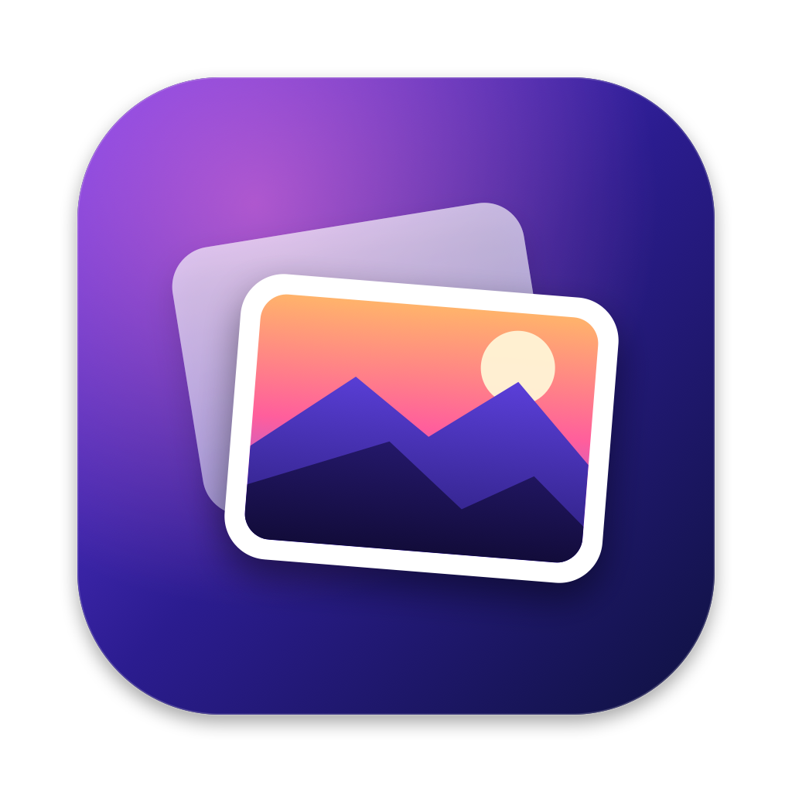

<p align="center">
  
</p>

<h1 align="center">Glimpse</h1>

<p align="center">
  A fast, modern image viewer for macOS.<br>
  Open one image, then browse the whole folder with the arrow keys.
</p>

---

## Why

Finder's Quick Look and Preview make it hard to look through a folder of images:

- You open one image and cannot go to the next one with the arrow keys.
- You must select all the images first, and then open them together.

Glimpse fixes this. Double-click an image (or choose **Open With ▸ Glimpse**), and every image in that folder is ready. Press **→** for the next one.

## Features

- **Browse a folder with the keyboard**: ← → / Space, Home / End, and a two-finger swipe on the trackpad.
- **Filmstrip and grid**: a thumbnail strip at the bottom, and a grid of the whole folder (press **G**).
- **Fast**: images decode in the background. The next and previous images load before you need them. A thumbnail shows at once while the full image loads.
- **Zoom and pan**: pinch, ⌥-scroll or the mouse wheel zooms at the pointer. Double-click switches between "fit" and a close-up. Drag to pan. 100% means one image pixel on one screen pixel.
- **Modern UI**: Liquid Glass on macOS 26 (translucent materials on macOS 14–15), a blurred ambient background from the current image, and full screen with controls that hide.
- **Info panel**: dimensions, color profile, camera, lens, exposure, date taken and GPS location (press **I**).
- **Clean up a folder**: ⌘⌫ moves the image to the Trash and shows the next one. ⌘Z puts it back.
- **Live folder**: new, removed and renamed files show up at once.
- **Formats**: everything that macOS can read, including JPEG, PNG, HEIC/HEIF, AVIF, WebP, GIF (animated), TIFF, BMP, PSD, ICNS and camera RAW. EXIF orientation is applied.
- **Native and small**: Swift, AppKit and SwiftUI. No Electron, no dependencies.

## Requirements

- macOS 14 Sonoma or later
- Xcode 16 or later (Xcode 26 to build the Liquid Glass UI)

## Build and install

```sh
git clone https://github.com/jiunshinn/glimpse.git
cd glimpse
make install      # builds a release app and copies it to /Applications
```

Other commands:

| Command | What it does |
| --- | --- |
| `make app` | Builds `build/Glimpse.app` (universal: Apple silicon and Intel) |
| `make run OPEN=~/Pictures` | Builds a debug app and opens a folder or an image |
| `make icon` | Draws the app icon again (`Resources/AppIcon.icns`) |
| `make clean` | Removes build files |

The app is signed ad hoc. If macOS blocks a copy that you downloaded, right-click the app and choose **Open**.

## Make Glimpse the default viewer

Choose **Glimpse ▸ Make Default Image Viewer…**. Or, in Finder: select an image, press ⌘I, choose Glimpse under **Open with**, and click **Change All…**.

## Keyboard shortcuts

Press **?** in the app to see this list.

| Key | Action |
| --- | --- |
| ← → / Space | Previous / next image (⇧Space: previous) |
| ↑ ↓ | Previous / next image; in the grid, move by a row |
| Home / End | First / last image |
| G | Grid of the whole folder |
| Return | Open the selected image (grid) |
| + / − | Zoom in / out (in the grid: larger / smaller tiles) |
| Z or double-click | Fit ↔ close-up |
| ⌘0 / ⌘9 | Actual size / zoom to fit |
| R / ⇧R | Rotate right / left (view only, the file does not change) |
| F | Full screen |
| I | Info panel |
| T | Thumbnail filmstrip |
| Esc | Close a panel, leave the grid, or exit full screen |
| ⌘⌫ | Move to Trash (⌘Z: undo) |
| ⌘C / ⌥⌘C | Copy image / copy file path |
| ⇧⌘R | Show in Finder |

Single-key shortcuts use the key position, so they also work with a non-Latin input source (for example, Korean).

## How it works

```
Sources/Glimpse
├── App/        App delegate, menus, window controller (toolbar, keyboard)
├── Model/      Folder scanning and sorting, folder watcher, ViewerModel (@Observable)
├── Imaging/    ImageIO decoding, background pipeline with caches, metadata, pasteboard
├── Canvas/     Zoomable NSScrollView; the image is a layer, so the GPU scales it
└── Views/      SwiftUI: filmstrip, grid, info panel, empty state, overlays
```

- One window shows one folder. Opening one file scans its folder. Opening several files shows only those files.
- `ImagePipeline` decodes on `OperationQueue`s. Full images are cached (up to 1/8 of the memory). Thumbnails are cached separately, and a thumbnail request stops when its cell scrolls away.
- The app is not sandboxed, because a sandboxed app cannot read the other files in the folder of the file that you opened. macOS can ask once for access to folders such as Desktop or Downloads.

## Roadmap

- Slideshow
- HDR display for photos with a gain map
- Sort by date taken
- Rename and tag files
- Compare two images side by side

## Contributing

Issues and pull requests are welcome. Please keep the app fast and free of dependencies.

## License

[MIT](LICENSE)
