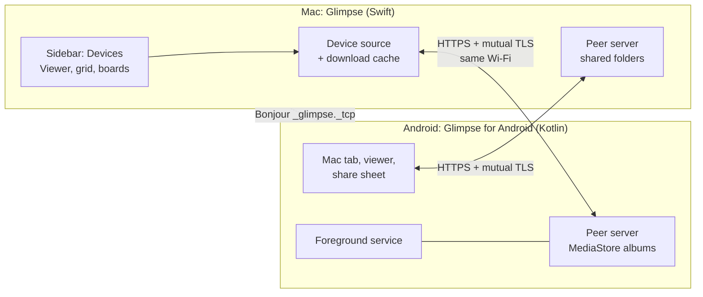
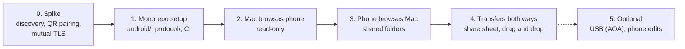

# Android companion: plan

Status: idea and planning phase (2026-11-03). Nothing is built yet.

**Goal:** Let a normal user browse the photos on their Android phone in Glimpse on the Mac, and browse the Mac's shared folders on the phone. The user must not turn on developer mode or install a driver.

Related documents:

- [monorepo.md](monorepo.md): one repository for the macOS app, the Android app and the protocol.
- [protocol.md](protocol.md): discovery, pairing, security and the API.

## Why a companion app

| Option | Result |
| --- | --- |
| USB with MTP | macOS does not support MTP. Finder cannot open the phone. A Mac MTP reader needs a C library (libmtp). |
| USB with adb | Works only when the user turns on developer mode and USB debugging. Normal users do not do this. |
| An SMB or WebDAV server app on the phone | Works with no code, but the user must set up a server, an IP address and a password. The UX is poor. |
| **Companion app on the local network** | The user installs one app and scans one QR code. After that, the devices connect automatically. **Chosen.** |

Later, a USB path is possible without developer mode with Android Open Accessory (AOA) mode. See phase 5.

## User experience

### Pairing (one time)

1. On the Mac, the user clicks **Connect Phone** in the sidebar. Glimpse shows a QR code and short instructions.
2. The user installs **Glimpse for Android**, opens it and taps **Pair with Mac**.
3. The phone scans the QR code. Both devices show "Connected to …".
4. The next time, the devices connect automatically when both are on the same Wi-Fi.

The app explains each system permission prompt (photos, local network, notifications) on its own screen before Android or macOS shows the prompt.

### On the Mac

- A **Devices** section in the sidebar shows the phone, for example "Jiun's Pixel". Under it are the albums: Camera, Screenshots, Downloads, and others.
- An album opens like a folder. The arrow keys, the grid, the filmstrip, Quick Search, the info panel and boards work as usual.
- A drag from a phone album to a Mac folder or a board copies the file.
- When the phone disconnects, the albums show as offline. Files that Glimpse already downloaded stay visible.

### On the phone

- A **Mac** tab shows only the folders that the user shared in Glimpse (**Share with Phone** on a sidebar folder). It never shows the full disk.
- The user swipes through photos and videos, pinches to zoom, and taps **Save to phone** or **Send to Mac**.
- The Android share sheet gets **Send to Glimpse on Mac**. It works from any app, for example Google Photos or the camera.
- While the Mac browses the phone, the phone shows a notification: "Glimpse: connected to MacBook". The notification has a **Disconnect** button.

## Architecture

- **Symmetric peers.** Each app runs the same small HTTPS API and is a client of the other. One API spec covers both directions.
- **Discovery.** Bonjour (mDNS) with the service type `_glimpse._tcp`. The Mac uses `NWListener` and `NWBrowser` (Network framework). Android uses `NsdManager`.
- **Security.** The QR code carries the Mac's certificate fingerprint and a one-time code. After pairing, each side pins the other side's certificate (mutual TLS). There is no cloud service, account or relay.
- **Shared contract.** The protocol lives in `protocol/` with sample JSON files. Both apps test against the same files. See [protocol.md](protocol.md).

## Changes to the Mac app

| Area | Change |
| --- | --- |
| Model | A device source lists albums and items from the API. It downloads each opened file to `~/Library/Caches/Glimpse/Devices/<device id>/`. The viewer then gets a normal file URL, so `ImageItem`, the canvas, the decoders and the video player do not change. |
| Sidebar | A new **Devices** section with the paired phones and their albums. Online and offline states. **Connect Phone** shows the QR code. |
| Thumbnails | Device items get their thumbnails from the API, not from a local decode. |
| Live updates | A device album gets changes from the event stream, not from `FolderWatcher` (FSEvents). |
| Copy and move | A drop of a device item on a folder downloads it there (`FileMover`). A move or delete on the phone is not in the first version. |
| Sharing | A **Share with Phone** list in `Workspace.json`. The peer server serves only these folders. |
| Info.plist | `NSLocalNetworkUsageDescription` and `NSBonjourServices` (`_glimpse._tcp`). macOS 15 and later asks for local network access. |

## The Android app

| Area | Choice |
| --- | --- |
| Language and UI | Kotlin, Jetpack Compose, Material 3. |
| Minimum version | Android 10 (API 29), to be confirmed. |
| Photo access | `MediaStore` with `READ_MEDIA_IMAGES` and `READ_MEDIA_VIDEO` (Android 13 and later). It supports the partial "selected photos" access on Android 14 and later. Albums are MediaStore buckets. |
| Server | Runs in a foreground service while a Mac is connected. The service type is probably `connectedDevice`; confirm it in the spike. |
| Discovery | `NsdManager`. |
| QR scan | CameraX with a barcode decoder. ML Kit is not open source, so an F-Droid build needs ZXing. |
| Screens | Pairing, Mac (shared folders), viewer, transfers, settings (paired Macs, permissions). |

## Constraints and risks

| Risk | Effect | Plan |
| --- | --- | --- |
| Not on the same Wi-Fi, or the Wi-Fi blocks device-to-device traffic (guest, office, hotel networks) | The devices cannot find each other. | Show a clear "not on the same network" message. Later: the phone's hotspot, or USB (phase 5). |
| Android stops background apps | The connection drops when the app is in the background. | A foreground service with a visible notification while connected. |
| Permission prompts | The user can deny them, and the feature stops working. | Explain each prompt first. Show a fix button when a permission is missing. |
| Changes to phone photos | Android asks the user on the phone to confirm each delete or move of another app's photo. | The first version is read-only for phone photos. |
| Large files (RAW, long videos) | Slow over Wi-Fi. | Range requests, a progress UI, and video streaming in a later phase. |
| Self-signed certificates | Android Keystore makes them. The Mac needs a way to make one. | Spike: Apple's `swift-certificates` package, or a small DER writer to stay dependency-free. |
| Google Play policy for photo permissions | Google Play can refuse broad photo access. | Glimpse is a gallery-type app, so it should qualify. It needs a declaration form. |

## Phases

| Phase | Scope | Done when |
| --- | --- | --- |
| 0. Spike | Two test apps find each other with Bonjour, pair with a QR code and make a mutual TLS request. No product UI. | A phone and a Mac pair, reconnect after a restart, and refuse an unpaired device. |
| 1. Monorepo setup | Add `android/` and `protocol/`, CI per platform. See [monorepo.md](monorepo.md). | Both apps build in CI from one repository. |
| 2. Mac browses the phone | Devices sidebar, albums, thumbnails, viewer, drag to copy. Read-only. | A user pairs and browses the Camera album with the arrow keys. |
| 3. Phone browses the Mac | **Share with Phone**, the Mac tab, the swipe viewer, save to phone. | A user opens a shared Mac folder on the phone and saves a photo. |
| 4. Transfers both ways | Share sheet target, upload to a Mac folder or board, progress UI. | A photo goes from Google Photos to a Glimpse board in two taps. |
| 5. Optional | USB with AOA (`IOUSBHost` on the Mac), delete and move on the phone, video streaming. | To be decided. |

## Open questions

- [ ] Distribution: Google Play, F-Droid, a direct APK, or more than one?
- [ ] Minimum Android version: is Android 10 (API 29) correct?
- [ ] Scope: browse only, or also automatic backup of new photos? This plan assumes browse only.
- [ ] Pairing without a camera: a 6-digit code with a check that both screens show the same words?
- [ ] More than one phone per Mac, and more than one Mac per phone?
- [ ] App name on Google Play: "Glimpse" or "Glimpse for Android"? Check for name conflicts.
