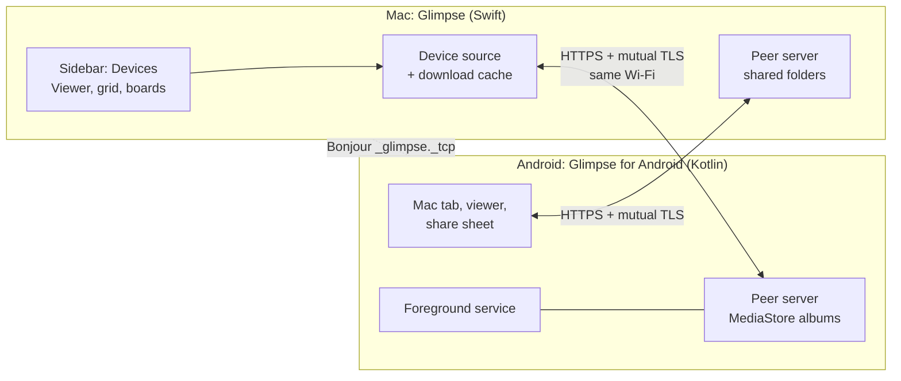
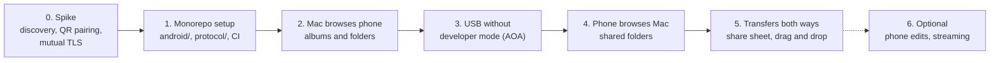

# Android companion: plan

Status (2026-11-03): phase 0 (pairing) and phase 2 (the Mac browses the phone's albums and folders) are built and tested on a Galaxy S21 with Android 15. See [Spike results](#spike-results) and [Phase 2 results](#phase-2-results). Phase 3 (USB without developer mode) and phase 4 (the phone browses the Mac's shared folders) work too; see [Phase 3 results](#phase-3-results) and [Phase 4 results](#phase-4-results). Phase 5 (transfers both ways) is next.

**Goal:** Let a normal user browse the photos on their Android phone in Glimpse on the Mac, and browse the Mac's shared folders on the phone. The user must not turn on developer mode or install a driver.

Related documents:

- [monorepo.md](monorepo.md): one repository for the macOS app, the Android app and the protocol.
- [protocol.md](protocol.md): discovery, pairing, security and the API.

## Why a companion app

| Option | Result |
| --- | --- |
| USB with MTP | macOS does not support MTP. Finder cannot open the phone. A Mac MTP reader needs a C library (libmtp). |
| USB with adb | Works only when the user turns on developer mode and USB debugging. Normal users do not do this. |
| An SMB or WebDAV server app on the phone | Works with no code, but the user must set up a server, an IP address and a password. The UX is poor. |
| **Companion app on the local network** | The user installs one app and scans one QR code. After that, the devices connect automatically. **Chosen.** |

Later, a USB path is possible without developer mode with Android Open Accessory (AOA) mode. See phase 5.

## User experience

### Pairing (one time)

1. On the Mac, the user clicks **Connect Phone** in the sidebar. Glimpse shows a QR code and short instructions.
2. The user installs **Glimpse for Android**, opens it and taps **Pair with Mac**.
3. The phone scans the QR code. Both devices show "Connected to …".
4. The next time, the devices connect automatically when both are on the same Wi-Fi.

The app explains each system permission prompt (photos, local network, notifications) on its own screen before Android or macOS shows the prompt.

### On the Mac

- A **Devices** section in the sidebar shows the phone, for example "Jiun's Pixel". Under it are the albums: Camera, Screenshots, Downloads, and others.
- An album opens like a folder. The arrow keys, the grid, the filmstrip, Quick Search, the info panel and boards work as usual.
- A drag from a phone album to a Mac folder or a board copies the file.
- When the phone disconnects, the albums show as offline. Files that Glimpse already downloaded stay visible.

### On the phone

- A **Mac** tab shows only the folders that the user shared in Glimpse (**Share with Phone** on a sidebar folder). It never shows the full disk.
- The user swipes through photos and videos, pinches to zoom, and taps **Save to phone** or **Send to Mac**.
- The Android share sheet gets **Send to Glimpse on Mac**. It works from any app, for example Google Photos or the camera.
- While the Mac browses the phone, the phone shows a notification: "Glimpse: connected to MacBook". The notification has a **Disconnect** button.

## Architecture



- **Symmetric peers.** Each app runs the same small HTTPS API and is a client of the other. One API spec covers both directions.
- **Discovery.** Bonjour (mDNS) with the service type `_glimpse._tcp`. The Mac uses `NWListener` and `NWBrowser` (Network framework). Android uses `NsdManager`.
- **Security.** The QR code carries the Mac's certificate fingerprint and a one-time code. After pairing, each side pins the other side's certificate (mutual TLS). There is no cloud service, account or relay.
- **Shared contract.** The protocol lives in `protocol/` with sample JSON files. Both apps test against the same files. See [protocol.md](protocol.md).

## Changes to the Mac app

| Area | Change |
| --- | --- |
| Model | `DeviceLibrary` keeps one cache folder per phone album or folder under `~/Library/Caches/Glimpse/Devices/<device id>/` (`Albums/<name>`, `Files/<path>`). Glimpse opens it as a normal folder, so `ImageItem`, the canvas, the decoders, boards and drag-out do not change. A photo arrives first as a preview with its real name. When the viewer shows it (or its neighbors), the full file takes its place, and the folder watcher reloads it. Videos and documents arrive whole. |
| Sidebar | A **Devices** section: each phone with **Photos** (albums) and **Files** (a folder tree that loads when a row opens). Online and offline states. **File › Connect Phone…** shows the QR code. |
| Thumbnails | The preview file comes from `GET /v1/items/{id}/thumbnail` (640 px asked; Samsung returns about 600 px). The pipeline decodes it like any file. |
| Live updates | Opening an album or folder syncs it again. The album list loads again every minute while the phone says hello. An event stream comes later. |
| Copy and move | A drop of a device item on a folder downloads it there (`FileMover`). A move or delete on the phone is not in the first version. |
| Sharing | A **Share with Phone** list in `Workspace.json`. The peer server serves only these folders. |
| Info.plist | `NSLocalNetworkUsageDescription` and `NSBonjourServices` (`_glimpse._tcp`). macOS 15 and later asks for local network access. |

## The Android app

| Area | Choice |
| --- | --- |
| Language and UI | Kotlin, Jetpack Compose, Material 3. |
| Minimum version | Android 10 (API 29), to be confirmed. |
| Photo access | `MediaStore` with `READ_MEDIA_IMAGES` and `READ_MEDIA_VIDEO` (Android 13 and later). It supports the partial "selected photos" access on Android 14 and later. Albums are MediaStore buckets. |
| File access | `MANAGE_EXTERNAL_STORAGE` ("All files access"), which the user turns on in Settings from the **Folders and files** row. Google Play allows it only for apps whose core feature needs it, such as file managers, after a declaration. Without it, the Mac shows only the albums. |
| Server | `SharingService`: a foreground service of type `connectedDevice` with a "Sharing with <Mac>" notification and a **Stop sharing** action. It runs the phone's HTTPS server (port 53818, or any free port), registers `_glimpse._tcp`, and says hello to each paired Mac every 30 seconds. The **Share with your Mac** switch starts and stops it, and the app remembers the switch. |
| Discovery | `NsdManager`. |
| QR scan | CameraX with ZXing core, in the app. The system camera also works: the `glimpse://pair` link opens the app, which then asks "Pair with <Mac>?". |
| Screens | Pairing, Mac (shared folders), viewer, transfers, settings (paired Macs, permissions). |

## Constraints and risks

| Risk | Effect | Plan |
| --- | --- | --- |
| Not on the same Wi-Fi, or the Wi-Fi blocks device-to-device traffic (guest, office, hotel networks, and some home routers such as the LG U+ GAPM-7200) | The devices cannot find each other. | "No route to host" gets its own message with a hotspot hint (done). USB without developer mode (AOA) is the real fallback; see the open questions. |
| Android stops background apps | The connection drops when the app is in the background. | A foreground service with a visible notification while connected. |
| Permission prompts | The user can deny them, and the feature stops working. | Explain each prompt first. Show a fix button when a permission is missing. |
| Changes to phone photos | Android asks the user on the phone to confirm each delete or move of another app's photo. | The first version is read-only for phone photos. |
| Large files (RAW, long videos) | Slow over Wi-Fi. | Range requests, a progress UI, and video streaming in a later phase. |
| Self-signed certificates | Android Keystore makes them. The Mac needs a way to make one. | Solved in the spike: a small DER writer and `SecIdentityCreate`. No library, no keychain prompt. |
| Google Play policy for photo permissions | Google Play can refuse broad photo access. | Glimpse is a gallery-type app, so it should qualify. It needs a declaration form. |

## Phases



| Phase | Scope | Done when |
| --- | --- | --- |
| 0. Spike | Two test apps find each other with Bonjour, pair with a QR code and make a mutual TLS request. No product UI. | A phone and a Mac pair, reconnect after a restart, and refuse an unpaired device. |
| 1. Monorepo setup | Add `android/` and `protocol/`, CI per platform. See [monorepo.md](monorepo.md). | Both apps build in CI from one repository. |
| 2. Mac browses the phone | Devices sidebar, albums and folders, previews, viewer, drag to copy. Read-only. **Done.** | A user pairs and browses an album and a folder with the arrow keys. |
| 3. USB without developer mode | Android Open Accessory (AOA): the Mac (`IOUSBHost`) switches the phone to accessory mode, and the same API runs over the USB link. Moved here because some home routers isolate Wi-Fi devices. **Done.** | A phone on a router that isolates devices browses over a cable, with no developer mode. |
| 4. Phone browses the Mac | **Share with Phone** (per phone), the Mac's folders on the phone, the swipe viewer, save to phone. **Done.** | A user opens a shared Mac folder on the phone and saves a photo. |
| 5. Transfers both ways | Share sheet target, upload to a Mac folder or board, progress UI. | A photo goes from Google Photos to a Glimpse board in two taps. |
| 6. Optional | Delete and move on the phone, video streaming, an event stream for live updates. | To be decided. |

## Spike results

Built on branch `feature/android-companion`, 2026-11-03.

| Done-when item | Result |
| --- | --- |
| A phone and a Mac pair | Passed. Emulator (Android 14): link sent with `adb shell am start -d`. Galaxy S21 (Android 15): QR code scanned with the in-app camera, over Wi-Fi. |
| They reconnect after a restart | Passed. Both apps restarted, and the phone showed "Connected" again. |
| An unpaired device is refused | Passed. No client certificate: TLS fails. An unpaired certificate: `401 not_paired`. A used or wrong code: `403 pairing_closed` or `401 bad_code`. |
| The Mac removes a phone | Passed. The phone shows "The Mac removed this phone. Pair again." |
| Bonjour discovery | Passed on the Galaxy S21. The Mac restarted on another port (49220, because 53817 was taken). The address in the QR code failed, but the phone found the Mac with `NsdManager`, connected and saved the new port. |
| QR scan with the camera | Passed on the Galaxy S21 (CameraX and ZXing). |
| Home router that isolates Wi-Fi devices | Found on the LG U+ GAPM-7200: the Mac and the phone both reach the router, but not each other ("No route to host"). The router has no setting to turn this off. Pairing worked on a phone hotspot instead. The phone now shows a message for this case. |

Decisions from the spike:

- The Mac key and certificate are stored in `~/Library/Application Support/Glimpse/Peer/Identity.json` with mode 0600, as `~/.ssh` keys are. The keychain asks for a password after each rebuild of an ad-hoc signed app, so it is not used yet. Move the key to the keychain when releases have a stable signature.
- The QR code holds only the address, the port, the fingerprint and the code. The phone reads the Mac's name from `GET /v1/info`. A shorter URL makes a less dense code that is easier to scan.
- The Mac server runs only while a phone is paired or the Connect Phone window is open.
- The Mac app stays at the repository root for now. `android/` and `protocol/` sit next to it. See [monorepo.md](monorepo.md).

How to run it:

```sh
# Mac: a test identity and device list, and the Connect Phone window at launch
GLIMPSE_PEER_DIR=/tmp/glimpse-peer GLIMPSE_DEBUG=pair .build/debug/Glimpse   # prints "[Peer] pairing URL: …"

# Android: build, install, and send the pairing URL from the Mac
cd android && ./gradlew installDebug
adb shell am start -a android.intent.action.VIEW -d '"glimpse://pair?…"' io.github.jiunshinn.glimpse
```

## Phase 2 results

Tested on 2026-11-03 with a Galaxy S21 (Android 15) on a phone hotspot.

| Check | Result |
| --- | --- |
| The phone appears under **Devices** without a new pairing | Passed. The phone says hello; the Mac takes its address from the connection. |
| **Photos**: albums with counts | Passed (Screenshots 10, Screen recordings 1). |
| **Files**: the folder tree, loaded when a row opens | Passed (DCIM › Screenshots, Music › Samsung, …). |
| An album opens as a grid at once | Passed. Previews of 270×600 px arrive first. |
| The viewer replaces a preview with the full file | Passed. The shown file and its neighbors became 1080 px; the others stayed previews. |
| An unpaired certificate is refused by the phone | Passed (`401 not_paired`). |
| Byte ranges for video | Passed (`206 Partial Content`). |

Known limits of this version:

- A photo that is only a preview gives the preview when you drag it out, copy it or read its info, until the viewer shows it once.
- Files deleted on the phone leave the cache at the next sync of that folder; changes do not arrive live yet.
- A video downloads whole before it plays.

## Phase 3 results

USB without developer mode, tested on 2026-11-03 with the Galaxy S21 (Android 15).

How it works:

1. Glimpse on the Mac watches USB (`UsbLink.swift`). When an Android phone is plugged in and no paired phone is online over Wi-Fi, it sends the AOA requests (manufacturer "Glimpse", model "Glimpse for Mac") and the phone switches to accessory mode. A phone that is plugged in at launch gets 35 seconds to connect over Wi-Fi first.
2. Android asks "Open Glimpse?" (with "Always open"). The app opens the accessory in `SharingService` (`UsbLink.kt`) and says who it is.
3. The link carries frames (stream id, type, length, payload). Each connection to a local port on the Mac becomes a stream to the phone's own HTTPS server. TLS, the pinned certificates and the API do not change.
4. The sidebar shows a cable icon, and the cable comes before Wi-Fi while it is connected.

| Check | Result |
|---|---|
| AOA support on the phone | Protocol version 2. macOS or adb holds the device, but a free interface sends the same requests. |
| Switch, "Open Glimpse?", link open | Passed. The sidebar shows the cable icon. |
| Albums through the cable | Passed, with TLS and the pinned certificates inside the link. |
| A 10.8 MB video | 0.37 s, about 29 MB/s, file intact. |
| 6 requests at the same time | Passed. |
| The app reopens the link after an update, with the cable still plugged in | Passed. |

Two bugs found and fixed on the way: the phone dropped a stream's first bytes when it connected the stream on another thread, and two start commands started two servers.

Google Play: AOA is a public Android API with no special permission, so it is allowed. The manifest marks `android.hardware.usb.accessory` as not required, so Play does not hide the app on phones without it. A sandboxed Mac App Store build would need the `com.apple.security.device.usb` entitlement; a notarized direct download needs nothing extra.

## Phase 4 results

Tested on 2026-11-03 with the Galaxy S21 over the USB cable, on a home router that isolates Wi-Fi devices.

How it works:

- **Mac:** a sidebar folder's menu has **Share with Phone ▸ All Phones** (also phones that pair later) and one checkable row per paired phone (`SharedFolders.swift`). The server answers each phone with only the folders shared with it: lists with subfolders, JPEG previews from Glimpse's own decoders, and files in 256 KB chunks with byte ranges. A path that leaves a shared folder is refused.
- **Phone:** tap a connected Mac card for its shared folders, a grid of previews, and a swipe viewer with pinch to zoom and **Save to phone** (Pictures, Movies or Download, each in a Glimpse folder).
- **Cable in both directions:** the phone has a local port whose connections go through the cable to the Mac's server. A first hello gets a reply, so either app can start first.

| Check | Result |
|---|---|
| Lists, subfolders, previews of a photo, a video and a PDF | Passed (Mac `curl` tests and on the phone) |
| A 10.8 MB video from the Mac | Identical copy; byte range `206` |
| A `..` path, an unpaired device | Refused |
| A folder shared with phone A only | Phone B cannot list it or download from it (`404`) |
| Viewer, zoom, Save to phone | Passed on the Galaxy S21 |
| The phone app shows "Connected with USB cable" when Wi-Fi isolates the devices | Passed |

Bugs found and fixed: the Mac crashed when a request used a client that the cable had replaced; the phone's cable port listened on `::1` while the app connected to `127.0.0.1`; the phone missed the Mac's hello when the Mac started first.

Known limits: videos do not play in the phone app yet (save them first); the phone cannot send files to the Mac yet (phase 5).

## Open questions

- [ ] Distribution: Google Play, F-Droid, a direct APK, or more than one?
- [ ] Minimum Android version: is Android 10 (API 29) correct?
- [ ] Scope: browse only, or also automatic backup of new photos? This plan assumes browse only.
- [ ] Pairing without a camera: a 6-digit code with a check that both screens show the same words?
- [ ] More than one phone per Mac, and more than one Mac per phone?
- [x] Move USB with Android Open Accessory (AOA) to right after phase 2. Decided 2026-11-03: some home routers isolate Wi-Fi devices with no setting to change it.
- [ ] Google Play and "All files access": file the declaration, or ship Files only in the F-Droid and APK builds?
- [ ] App name on Google Play: "Glimpse" or "Glimpse for Android"? Check for name conflicts.
