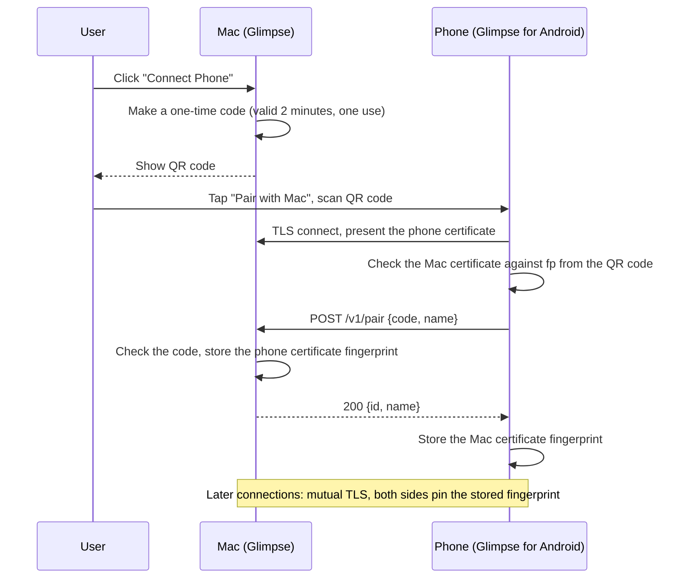

# Android companion: protocol

Status: version 1 started (2026-11-03). The phase 0 spike serves `/v1/info`, `/v1/pair` and a stub `/v1/albums`. The machine-readable spec is [protocol/openapi.yaml](../../protocol/openapi.yaml). Back to the [plan](README.md).

Both apps run the same API and are clients of each other ("symmetric peers"). The Mac serves its shared folders. The phone serves its MediaStore albums.

## Discovery

- Bonjour (mDNS) service type: `_glimpse._tcp`.
- TXT record:

| Key | Value | Example |
| --- | --- | --- |
| `id` | Device ID: the first 16 characters of the base64url SHA-256 fingerprint of the device certificate | `q3Xb9…` |
| `n` | Device name | `Jiun's MacBook` |
| `p` | Platform | `mac` or `android` |
| `v` | Protocol versions, comma separated | `1` |

A device connects only to a peer whose `id` is in its paired list. It ignores all other `_glimpse._tcp` services.

## Pairing

The Mac shows a QR code with this URL:

```
glimpse://pair?h=192.168.1.20&port=53817&fp=<mac cert SHA-256, base64url>&code=<one-time code, 128 bits, base64url>
```

The URL is short on purpose: a short URL makes a QR code that is easier to scan. The phone reads the Mac's name from `GET /v1/info`.



Rules:

- The one-time code is valid for 2 minutes and for one use. After 5 wrong codes, the Mac closes the pairing window.
- Each device makes its key pair one time and keeps it. On the phone, the key is in Android Keystore. On the Mac, the key is in `Identity.json` (mode 0600) under `~/Library/Application Support/Glimpse/Peer/`. The keychain comes later, when releases have a stable signature.
- A `glimpse://pair` link that opens the app from outside (for example, the system camera) asks "Pair with <Mac>?" first. A code scanned inside the app pairs at once.
- **Unpair** on either device deletes the stored fingerprint. The other device then gets `401` and shows "Pair again".

## Transport

- HTTPS (TLS 1.3) with mutual TLS. Each side accepts only a pinned certificate.
- Port: chosen by the system, advertised with Bonjour.
- JSON with UTF-8 for metadata. Raw bytes for thumbnails and file content.
- File content supports `Range` requests, for large files and video seeking.
- Errors: an HTTP status and `{"error": "<code>", "message": "<text for logs>"}`.

## API version 1

| Method and path | Purpose | Reply |
| --- | --- | --- |
| `GET /v1/info` | Device name, platform, app version, protocol versions, capabilities | JSON |
| `POST /v1/pair` | Pairing (only while a pairing window is open) | JSON |
| `GET /v1/albums` | Albums: MediaStore buckets on the phone, shared folders on the Mac | JSON list |
| `GET /v1/albums/{albumId}/items?cursor=&limit=` | Items in an album, newest first, in pages | JSON page |
| `GET /v1/items/{itemId}/thumbnail?size=256` | A thumbnail, longest side in pixels | `image/jpeg` |
| `GET /v1/items/{itemId}/content` | The original file | the file's MIME type |
| `POST /v1/albums/{albumId}/uploads` | Send a file to the peer (phase 4) | JSON item |
| `GET /v1/events` (WebSocket) | Changes: album added or removed, items changed | JSON messages |

### Shapes

```json
// GET /v1/info
{
  "id": "q3Xb9…",
  "name": "Jiun's Pixel",
  "platform": "android",
  "appVersion": "0.1.0",
  "protocol": [1],
  "capabilities": ["browse", "upload"]
}
```

```json
// GET /v1/albums
{
  "albums": [
    { "id": "b-1028742", "name": "Camera", "count": 4210, "coverItemId": "i-88213" },
    { "id": "b-5521",    "name": "Screenshots", "count": 512, "coverItemId": "i-88190" }
  ]
}
```

```json
// GET /v1/albums/b-1028742/items?limit=200
{
  "items": [
    {
      "id": "i-88213",
      "name": "PXL_20261103_091522.jpg",
      "kind": "image",
      "mime": "image/jpeg",
      "size": 3481920,
      "width": 4080,
      "height": 3072,
      "taken": "2026-11-03T09:15:22Z",
      "modified": "2026-11-03T09:15:23Z"
    }
  ],
  "next": "c-200"
}
```

```json
// GET /v1/events message
{ "type": "items.changed", "albumId": "b-1028742" }
```

`kind` is one of `image`, `video` or `document`, as in Glimpse's own file types.

### IDs

- IDs are opaque strings. A client must not parse them.
- Phone: from the MediaStore `BUCKET_ID` and `_ID`.
- Mac: a shared folder ID plus the base64url relative path. The server rejects a path that leaves the shared folder (`..`, symbolic links that point out).

## Compatibility rules

- A new optional field does not change the version. A client ignores fields it does not know.
- A removed or changed field needs a new version (`/v2/`). A device supports the old version for at least one release.
- `GET /v1/info` lists the supported versions. Both sides use the highest version that both support.
- If no version matches, the app shows "Update Glimpse on your Mac" or "Update Glimpse on your phone".

## Questions for the spike

- [x] Make a self-signed certificate on the Mac: a small DER writer (`PeerIdentity.swift`) and `SecIdentityCreate`. No library.
- [x] `NWListener` with mutual TLS works with OkHttp, a pinning `X509TrustManager` and a client key in Android Keystore.
- [ ] Does `NsdManager` find the Mac reliably on Android 10 to 16? Do some phones need a multicast lock? (Needs a real phone.)
- [ ] Which Kotlin server for phase 2, when the phone serves its albums: Ktor CIO or a small custom server?
- [ ] Does the Android foreground service type `connectedDevice` fit this use, and which permission does it need?
